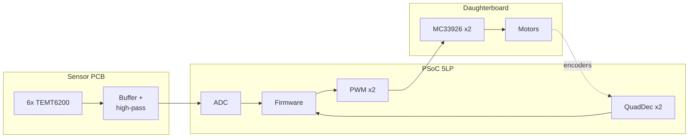
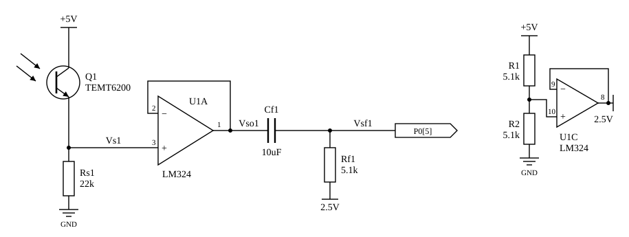
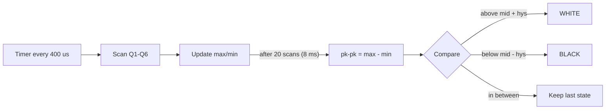
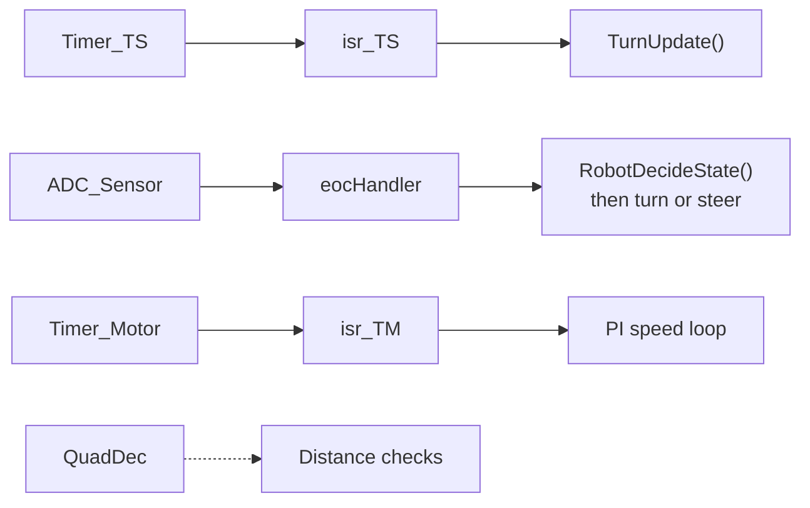
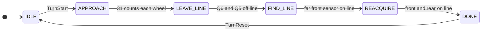
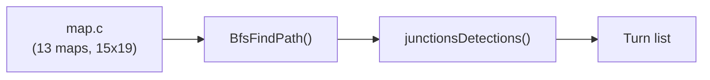
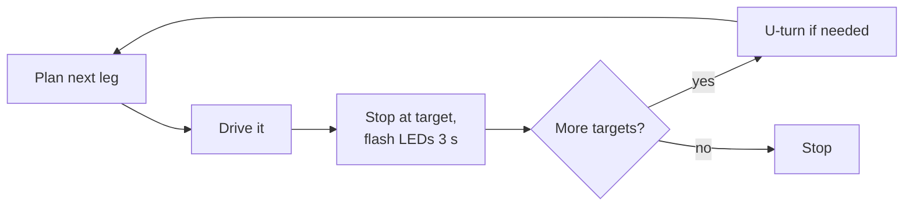

# COMPSYS 301 Line-Following Robot

COMPSYS 301 group project (UoA, S2 2026, group of 4). Robot follows a maze projected on the floor, plans the path with BFS on the PSoC and drives to the target cells.


## Hardware

- PSoC 5LP, CY8CKIT-059
- Sensor PCB (CS301_14): 6x TEMT6200 phototransistors, 2x LM324
- Course daughterboard: 2x MC33926 H-bridge
- 12 V gearmotors, 19:1, 416 rpm no-load, 65 mm wheels
- Magnetic encoders, 228 counts per wheel rev

IN2 on the MC33926 is tied high, so PWM is inverted (compare 99 = stopped).



## Sensor board


- Q3, Q4 (outer): junction / branch detection
- Q5, Q6 (front): steering, and finding the line during turns
- Q1, Q2 (rear): heading, end of turn

Q3 and Q4 got moved further out onto small boards later on because they were picking up false branches.

<br clear="right">

Circuit for one channel (fitted values):



Rs turns the photocurrent into a voltage, the LM324 buffers it, then Cf/Rf is a high-pass that removes the ambient DC and re-biases the signal to 2.5 V for the ADC. fc is about 3.5 Hz with the fitted parts.

Rs worst case. Measured under the lab's ambient light (room lights on), white surface, brightest projector:

| Rs | Max Vs |
|---|---|
| 22k | 2.65 V |
| 27k | 3.19 V |
| 33k | 3.50 V |
| 47k | 4.24 V (clipped, earlier test) |

LM324 input limit is ~3.7 V. We had 27k at first, but two phototransistors differed by 0.52 V so a bad one could get to ~3.83 V. Went with 22k.

PCB v1 used a 21.9 Hz low-pass instead, which was the wrong way round (keeps the DC, attenuates the 120 Hz flicker).

| Top | Bottom |
|---|---|
|  |  |

87.88 x 127 mm, 2 layer, all through-hole. Plugs onto the PSoC kit and passes the motor/encoder lines through to the daughterboard. Pinout: [interconnect sheet](doc/psoc-breakout-interconnect-sheet.png).

The Altium schematic still has some old values. What's actually soldered:

| Part | Schematic | Fitted |
|---|---|---|
| Q1-Q6 | VEMT3700 | TEMT6200 |
| Rs1-Rs6 | 50k | 22k |
| Rf1-Rf6 | 6.8k | 5.1k |
| R1, R2 | 2.5k | 5.1k |
| RLED1-6 | 1k | 2.2k |

## Reading the sensors

Projected white flickers at 120 Hz and room lighting moves the DC level by ~1 V, so we threshold on peak-to-peak instead of the level. Between low and high room light pk-pk only changed by <0.1 V.



Thresholds in ADC counts ([sensor.c](Software/CS301_Class.cydsn/sensor.c)):

| | Q1 | Q2 | Q3 | Q4 | Q5 | Q6 |
|---|---|---|---|---|---|---|
| mid | 216 | 206 | 254 | 299 | 193 | 197 |
| hys | 27 | 28 | 35 | 47 | 21 | 22 |

One threshold for all six (737 ± 98) didn't work on the dimmer projector. `sensor_threshold_shift` (+50) is there for when the projector brightness changes. See [sensor.md](Software/CS301_Class.cydsn/sensor.md) and [thresholds.md](Software/CS301_Class.cydsn/thresholds.md).

We first ran the ADC free-running, but 20 scans only took 1.5 ms, much shorter than one flicker period, so it was changed to timer-triggered. ADC_SAR_Seq + DMA instead of a mux, so all six update every 8 ms (the mux version was 48 ms).

## Firmware

C, PSoC Creator, no RTOS. ISRs just set flags / fill the sensor frame, main loop does the work.



- 400 us: ADC scan
- 4.8 ms: turn state machine
- 8 ms: new sensor frame, steering
- 100 ms: PI speed loop
- Stops if no sensor frame for 50 ms, or no line for 400 ms
- Turn times out after 4 s

## Line following

Steering picks the wheel targets, each wheel has its own PI loop on encoder speed (Kp 0.8, Ki 0.1, 10 Hz).


Correction c from [line_follow.c](Software/CS301_Class.cydsn/line_follow.c). X = on the line, positive = steer right.

| Front Q6 Q5 \ Rear Q1 Q2 | `. .` | `. X` | `X .` | `X X` |
|---|:-:|:-:|:-:|:-:|
| `. .` | last side, 10 | +8 | -8 | last side, 8 |
| `. X` | +3 | +2 | +2 | +1 |
| `X .` | -3 | -2 | -2 | -1 |
| `X X` | last side, 2 | -1 | +1 | 0 |

"Last side" = steer towards where the line was last seen. Started with a P/D formula, the table was easier to tune. Base speed is 18% (~0.11 m/s).

## Junctions and turns

[robot_state.c](<Software/Lucas's state deciding code/robot_state.c>):

| Q3 | Q4 | State |
|:-:|:-:|---|
| X | X | `JUNCTION` |
| X | . | `LEFT_BRANCH` |
| . | X | `RIGHT_BRANCH` |
| all six off | | `LINE_LOST` |
| otherwise | | `FOLLOW_LINE` |

No gyro. [turn.c](<Software/Lucas's turning code/turn.c>) drives forward 31 encoder counts to get the axle over the junction, then spins until the front sensors pick up the new line.



Approach is 20% both wheels, the spin is ±15%. Over 4 s goes to FAULT. U-turn ([uturn.c](Software/CS301_Class.cydsn/uturn.c)) spins until both wheels have done 200 counts.

## Path planning



The robot only knows junctions, not its grid position, so the BFS path gets converted to a turn list (e.g. skip 2 right junctions, turn right at the 3rd). A turn only happens if the junction count and encoder distance both match.

Example, `map_test`:

| # | Cell | Junction | Action |
|---|---|---|---|
| 1 | (2, 0) | T, branch left | Left |
| 2 | (2, 6) | Corner right | Skip 2 right junctions, then right |
| 3 | (3, 6) | Corner left | Left |
| 4 | (3, 9) | Corner right | Right |

BFS vs A* over all 27,390 start/goal pairs gave the same path lengths. A* expanded 63% fewer cells but BFS fits in fixed arrays, so we used BFS.

Multiple targets:



## Repo layout

```text
Software/
  CS301_Class.cydsn/            main firmware (PSoC Creator)
    main.c                      main loop
    sensor.c                    ADC ISR, thresholds
    line_follow.c               steering table
    motorControl.c              PWM, PI speed loop
    bfs.c, branchSearch.c       planner, turn list
    map.c                       maps
    uturn.c
    tests/                      line follower host tests
  Lucas's turning code/         turn.c + tests
  Lucas's state deciding code/  robot_state.c + tests
  Lucas's algorithm code/       BFS, A* (Python, C)
  Abdur Code/                   DFS (MATLAB)
  CS301_MotorUnitTest.cydsn/
  CS301_SensorTestUnit.cydsn/
Hardware/
  PCBv2/                        final sensor board (Altium)
  PCB/                          v1
  LTspice.asc
Sensor_Design/                  resistor sweeps, ambient light tests
Phototransistors_scope_data(0805 SMD)/
V_sense&&V_adc_Data(light_off)/
maps_oct/courses/               test courses
Harold_labs/                    individual labs
Meeting Logs/
doc/
```

## Status

Can pick up multiple targets. Still comes off the line sometimes, needs more tuning.


